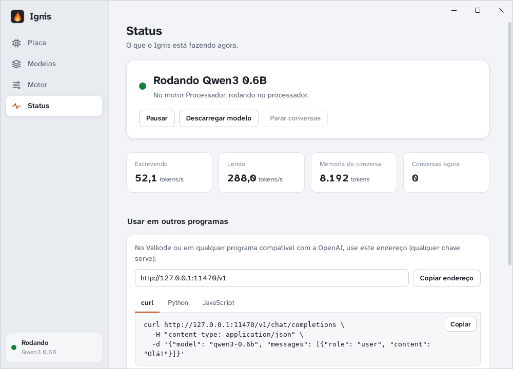
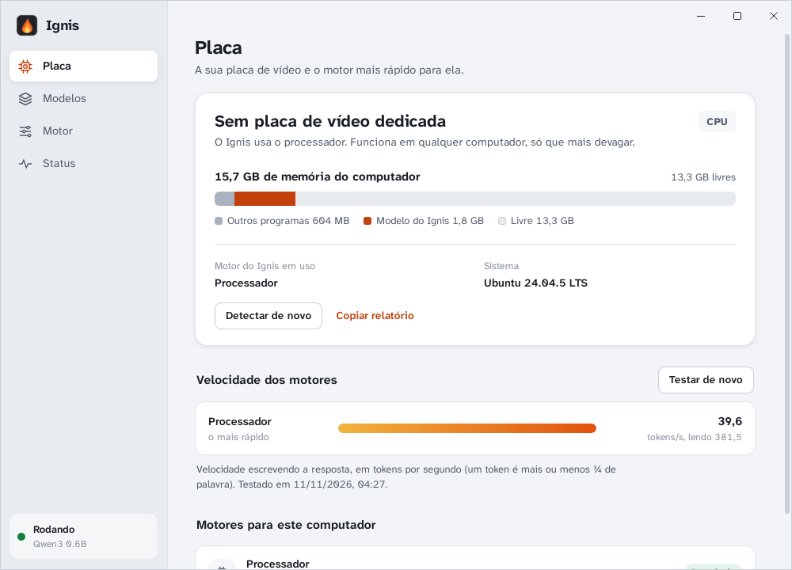
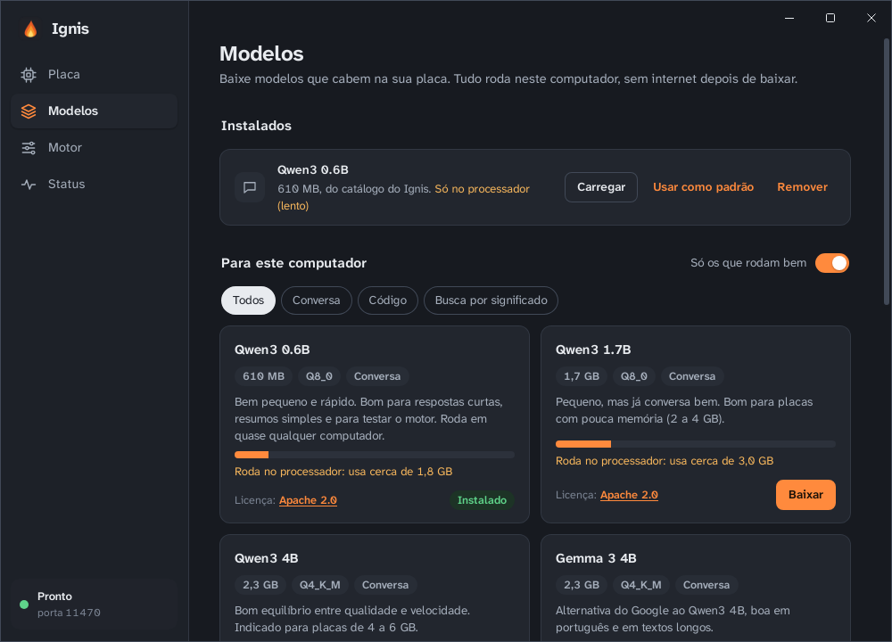

<p align="center"></p>

<h1 align="center">Ignis</h1>

<p align="center"><strong>Motor de IA local, leve, para Windows e Linux.</strong><br>
Roda modelos de IA no seu computador com a melhor aceleração da sua placa (AMD, NVIDIA, Intel ou só o processador)<br>
e atende o Valkode, o Azura Voice e qualquer programa por uma porta local compatível com a API da OpenAI.</p>

<p align="center">
  <a href="https://github.com/kaikydev1-jpg/Ignis/releases/latest"></a>
  <a href="https://github.com/kaikydev1-jpg/Ignis/actions/workflows/ci.yml"></a>
  
  
</p>

<p align="center"></p>

## Baixar

Versão oficial mais recente: **[página da versão](https://github.com/kaikydev1-jpg/Ignis/releases/latest)**. Os links abaixo sempre baixam a última versão.

| Sistema | Baixe | Como instalar |
|---|---|---|
| **Windows 10 e 11** | [Ignis-Windows.exe](https://github.com/kaikydev1-jpg/Ignis/releases/latest/download/Ignis-Windows.exe) | Abra o arquivo (não pede administrador) |
| **Fedora 44** | [Ignis-Fedora.rpm](https://github.com/kaikydev1-jpg/Ignis/releases/latest/download/Ignis-Fedora.rpm) | `sudo dnf install ./Ignis-Fedora.rpm` |
| **Fedora Atomic** (Silverblue, Kinoite, Bazzite, Bluefin, Aurora) | [Ignis-Flatpak.flatpak](https://github.com/kaikydev1-jpg/Ignis/releases/latest/download/Ignis-Flatpak.flatpak) | `flatpak install --user ./Ignis-Flatpak.flatpak` |
| **Matsu OS** (Matsu 27 OS e próximos) | [Ignis-Matsu-OS.flatpak](https://github.com/kaikydev1-jpg/Ignis/releases/latest/download/Ignis-Matsu-OS.flatpak) | Abra na loja de aplicativos do sistema, ou `flatpak install --user ./Ignis-Matsu-OS.flatpak` |
| **Ubuntu, Debian, Mint, Pop!_OS, Zorin** | [Ignis-Ubuntu-Debian.deb](https://github.com/kaikydev1-jpg/Ignis/releases/latest/download/Ignis-Ubuntu-Debian.deb) | `sudo apt install ./Ignis-Ubuntu-Debian.deb` |
| **Arch, openSUSE e outras** | [Ignis-Linux.AppImage](https://github.com/kaikydev1-jpg/Ignis/releases/latest/download/Ignis-Linux.AppImage) | `chmod +x Ignis-Linux.AppImage` e abrir (ou use o Flatpak) |

**Pelo terminal, em qualquer Linux:** descobre o seu sistema, baixa a versão certa, confere e instala.
```bash
curl -fsSL https://github.com/kaikydev1-jpg/Ignis/releases/latest/download/instalar.sh | bash
```

- **Windows:** se aparecer "O Windows protegeu o computador", clique em **Mais informações → Executar assim mesmo** (o instalador ainda não tem assinatura digital).
- **GNOME:** o ícone perto do relógio precisa da extensão [AppIndicator](https://extensions.gnome.org/extension/615/appindicator-support/) (no Fedora: `sudo dnf install gnome-shell-extension-appindicator`). O KDE mostra sem extensão.
- **Conferir os arquivos:** as somas SHA-256 ficam em `SHA256SUMS.txt`, na página da versão.

### Versões de teste
Cada mudança no código gera instaladores de teste automaticamente, separados da versão oficial:
**[Actions → Instaladores](https://github.com/kaikydev1-jpg/Ignis/actions/workflows/instaladores.yml)**. Abra a execução mais recente com ✓ verde e baixe em *Artifacts*. Para baixar, é preciso estar logado no GitHub, e cada execução fica disponível por 90 dias.

<table><tr>
<td></td>
<td></td>
</tr></table>

## O que ele faz
- **Detecta a placa** (fabricante, modelo, memória de vídeo, driver, alvo `gfx` da AMD).
- **Escolhe o motor:**
  - AMD: ROCm/HIP (quando a placa e o sistema suportam) e Vulkan;
  - NVIDIA: CUDA e Vulkan;
  - Intel e outras: Vulkan;
  - sempre: processador.

  Na primeira vez, testa cada motor por até 30 s. Para cada modelo, usa a placa
  quando ele cabe nela, e aprende com o uso qual motor é mais rápido para aquele
  modelo (ou use "Testar velocidade" no modelo). Se um motor falha ou cai, passa
  para o próximo sozinho e avisa.
- **Baixa só o motor que serve para a sua placa**: o instalador não leva motores nem modelos.
- **Modelos:**
  - catálogo curto escolhido a dedo e filtrado pela sua placa ("Roda bem na sua placa");
  - download do Hugging Face com cancelar, retomar e conferência de hash;
  - reaproveita modelos que já estão no computador (Ollama, Hugging Face, LM Studio): não baixa de novo o que já existe, e nunca apaga nada lá.
- **Qualquer modelo do Hugging Face:**
  - busca dentro do app, com versões, tamanho e "cabe na sua placa?" (lendo o cabeçalho, sem baixar tudo);
  - modelos em várias partes e modelos que entendem imagem/áudio (arquivo `mmproj`);
  - modelos que pedem aceite dos termos usam a conta de cada pessoa (token guardado só no computador).
- **Orçamento de memória:** escolhe quantas camadas vão para a placa e o tamanho do contexto pela VRAM livre, e avisa antes quando o modelo não cabe.
- **Libera a placa:** descarrega o modelo depois de 10 min parado (configurável), para jogos e outros programas.
- **API local** em `http://127.0.0.1:11470` (só no seu computador):
  - compatível com a OpenAI: `/v1/models`, `/v1/chat/completions` (com streaming e Parar), `/v1/embeddings`;
  - rotas próprias em `/motor/*`. Contrato: [CONTRATO_VALKODE.md](CONTRATO_VALKODE.md).
- **Janela:** barra de título integrada, com os botões no jeito de cada sistema (Windows 11; no Linux, bolinhas estilo Mac, GNOME ou KDE, conforme o seu; no Matsu OS, as cores exatas do sistema); temas claro e escuro.
- **Leve em repouso:** ≈60 MB de RAM e ≈0% de processador sem modelo carregado.
- **Sem telemetria.** Só se conecta ao GitHub (motores) e ao Hugging Face (modelos), por ação sua.

## ROCm no Linux (opcional)
Sem fazer nada, as placas AMD já usam o Vulkan. O ROCm vem dos repositórios da distro e às vezes é mais rápido:
- Fedora: `sudo dnf install rocm-hip hipblas rocblas`;
- Fedora Atomic: `sudo rpm-ostree install …` e reiniciar;
- depois, coloque seu usuário nos grupos `render` e `video`.

O Ignis mostra o comando certo para a sua distro. No Flatpak o ROCm do sistema
não fica visível; lá ele usa Vulkan, que já vem com o Mesa.

## Usar
1. Abra o Ignis e clique em **Preparar o Ignis**: ele baixa os motores da sua placa e um modelo pequeno, e testa qual motor é mais rápido.
2. Em **Modelos**, baixe um recomendado.
3. Aponte o seu programa para `http://127.0.0.1:11470/v1` (qualquer chave de API).

Fechar a janela deixa o Ignis na bandeja. Para encerrar, use **Sair** no menu do ícone.

## Para desenvolver
Requisitos: Rust estável. No Linux, também
`libwebkit2gtk-4.1-dev libayatana-appindicator3-dev librsvg2-dev libxdo-dev libssl-dev`.
```bash
cargo test --workspace
```
```bash
cargo run -p ignis-app
```
```bash
cargo run -p ignis-cli -- detectar
```
Gerar instaladores:
```bash
cd app/src-tauri && cargo tauri build
```
Para o Flatpak: `packaging/flatpak/build.sh <arquivo.deb>`.

Teste com o llama-server oficial (baixe o pacote CPU e um GGUF pequeno):
```bash
IGNIS_TEST_ENGINE_ARCHIVE=llama-b12271-bin-ubuntu-x64.tar.gz IGNIS_TEST_MODEL=qwen2.5-0.5b-instruct-q4_k_m.gguf cargo test -p fake-llama-server --test integracao_real -- --nocapture
```

### Estrutura
| Pasta | O que tem |
|---|---|
| `crates/ignis-core` | Núcleo: detecção, escolha de motor, orçamento, modelos, Ollama, supervisor do llama-server, API |
| `crates/fake-llama-server` | Placa simulada (imita o llama-server) e testes de ponta a ponta |
| `crates/ignis-cli` | Linha de comando para diagnóstico (`detectar`, `servir`, `gguf`, `ollama`) |
| `app/src-tauri` | Aplicativo (bandeja + janela em processo separado) |
| `app/ui` | Janela em HTML/CSS/JS puro, em português |
| `manifest/` | Motores fixados (`motores.json`) e catálogo de modelos (`catalogo.json`) |
| `packaging/flatpak` | Manifesto do Flatpak |
| `.github/workflows` | CI (testes) e instaladores |

Documentos: [BRIEFING.md](BRIEFING.md) (o que é, instalar, usar e ligar um app),
[ESTADO.md](ESTADO.md) (situação e decisões),
[TESTE_DO_CRIADOR.md](TESTE_DO_CRIADOR.md) (testes na placa real),
[CONTRATO_VALKODE.md](CONTRATO_VALKODE.md) (API), [AVISOS.md](AVISOS.md) (licenças).

## Licença
MIT. Licenças de terceiros: [AVISOS.md](AVISOS.md).
